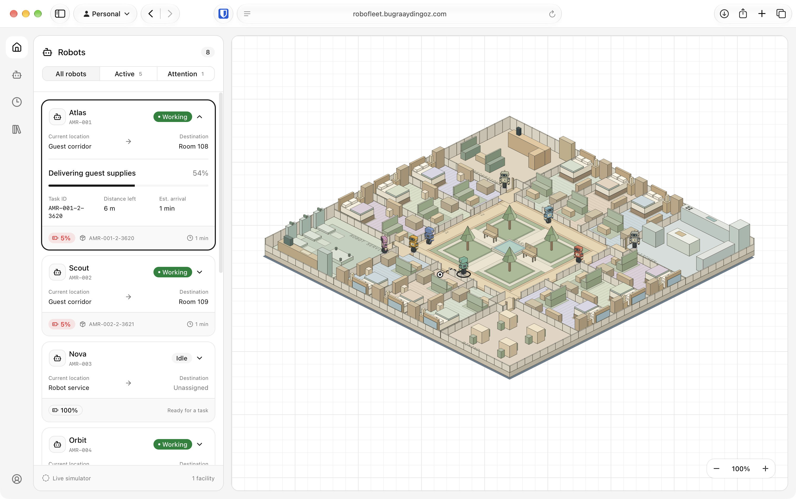
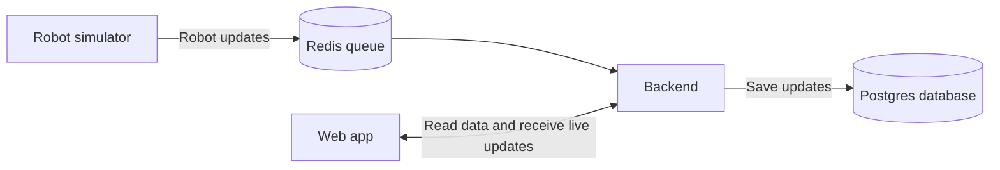

# RoboFleet

A live dashboard for a fleet of hotel robots. View their status, battery, and tasks,
and follow their movement on an interactive isometric map.

[Open RoboFleet](https://robofleet.bugraaydingoz.com)



Built with React, Vite, and shadcn on the frontend, and Hono, Redis, and Postgres on the backend.

## Architecture



The simulator sends robot updates every second. The backend saves them before
streaming them to the web app using server-sent events. Postgres stores maps,
the latest robot state, and one hour of telemetry history. The simulator and
queue worker run inside the backend process.

## Development

Requires Node.js 24+, pnpm 12+, and Docker. Complete the
[environment and database setup](../../infra/README.md#local-development) once.
Run all commands below from the repository root.

```sh
pnpm install
pnpm dev:robofleet
```

Open [localhost:5173](http://localhost:5173). The command starts the shared database
and Redis, applies migrations, and runs the backend and web app.

## Tests

```sh
pnpm --filter 'robofleet-*' lint
pnpm --filter 'robofleet-*' check
pnpm --filter 'robofleet-*' test
pnpm db:test:robofleet
```

Tests include unit tests and Playwright browser tests. The last command runs backend
integration tests against Postgres and Redis; create the test database during setup.

## Deployment

Pushes to `master` deploy automatically through GitHub Actions. To update services
manually, run this from the repository checkout on the server:

```sh
docker --context rootless compose --env-file .env \
  -f infra/docker-compose.yml up -d --build --wait
```

See [infrastructure setup](../../infra/README.md#deployment) for first-time deployment
and the [backend README](../robofleet-api/README.md) for endpoints and database commands.
